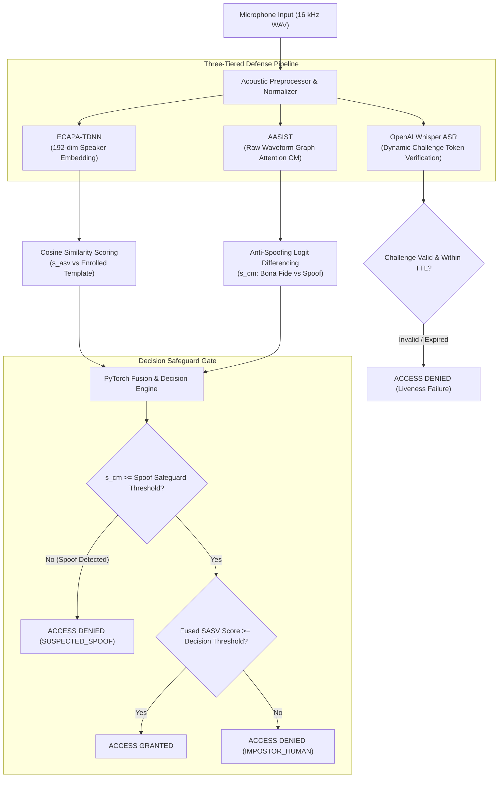

# Integrated Spoof-Aware Speaker Verification (SASV) for Secure Voice Authentication

[](https://www.python.org/downloads/)
[](https://pytorch.org/)
[](https://fastapi.tiangolo.com)
[](https://speechbrain.github.io/)
[](https://github.com/clovaai/aasist)
[](https://github.com/openai/whisper)

A robust, enterprise-grade biometrics security system that combines **Deep Speaker Verification (ASV)**, **State-of-the-Art Anti-Spoofing Countermeasures (CM)**, and **Dynamic Acoustic Liveness Verification** to defend against voice cloning, generative deepfakes, and loudspeaker replay attacks.

---

## 📌 Motivation & Problem Statement

Modern generative AI (neural vocoders, diffusion audio models, zero-shot voice cloners like ElevenLabs and VALL-E) can replicate any human voice with as little as 3 seconds of reference audio. 

Traditional Automatic Speaker Verification (ASV) systems verify identity based on acoustic spectral profiles but are completely blind to synthetic generation artifacts or replay attacks. This project implements a **Spoof-Aware Speaker Verification (SASV)** architecture that answers three critical questions before granting access:

1. **Identity:** *"Does this voice match the enrolled user's acoustic template?"* &rarr; **ECAPA-TDNN**
2. **Authenticity:** *"Is this speech from a living human or an AI deepfake / playback speaker?"* &rarr; **AASIST**
3. **Liveness:** *"Is the speaker actively reciting a randomized, time-bounded challenge right now?"* &rarr; **OpenAI Whisper ASR**

---

## 🏛️ System Architecture



---

## 🚀 Key Modules & Capabilities

- **Deep Speaker Verification (SpeechBrain ECAPA-TDNN):** 1D dilated convolutions with Squeeze-and-Excitation (SE) channel attention, Multi-layer Feature Aggregation (MFA), and Attentive Statistical Pooling (ASP) extracting robust 192-dimensional speaker embeddings.
- **Raw Waveform Anti-Spoofing (AASIST):** SincNet filterbanks operating on raw audio coupled with heterogeneous spectro-temporal graph attention networks (GAT) trained on the ASVspoof 2019 Logical Access (LA) benchmark.
- **Dynamic Acoustic Liveness & Anti-Replay:** Server-issued, single-use numeric and phonetic challenge phrases with a 20-second time-to-live (TTL), transcribed and checked by OpenAI Whisper to prevent pre-recorded playback and relay attacks.
- **Countermeasure Safeguard Gating:** A hard anti-spoof safeguard gate that unconditionally rejects high-confidence spoof attacks even if an impostor manages to elicit high speaker similarity.
- **FastAPI Real-Time Service:** Low-latency REST endpoints for user enrollment, challenge generation, authentication, and forensic audio playback.
- **Modern Interactive Web Interface:** Responsive dark-mode glassmorphic dashboard featuring real-time audio visualization, challenge generation, verification metrics, decision breakdowns, and trial history.

---

## 📂 Repository Structure

```text
├── docs/                      # Architectural manuals, guides, and diagnostic notes
│   ├── PROJECT_GUIDE.md       # Comprehensive technical & non-technical project guide
│   ├── benchmark_provenance_and_security_analysis.md
│   └── GENUINE_REJECTION_DIAGNOSIS.md
├── frontend/                  # Glassmorphic web user interface
│   ├── index.html             # Single-page dashboard
│   ├── app.js                 # Verification, recording & challenge client logic
│   └── styles.css             # Design system styling & dark mode aesthetics
├── models/                    # Model weights and checkpoint configurations
│   ├── checkpoints/           # Checkpoint configs and parameter metadata
│   ├── sasv_fusion.pt         # Trained score fusion model
│   └── fusion_metadata.json   # Calibration thresholds and operating points
├── src/                       # Core python implementation
│   ├── api/                   # FastAPI backend service and recording history store
│   ├── core/                  # Audio preprocessing and decision logic
│   ├── eval/                  # SASV 2022 protocol evaluation and scoring utilities
│   └── models/                # ECAPA-TDNN, AASIST, and Fusion model definitions
├── scripts/                   # Benchmarking, smoke tests, and startup scripts
│   ├── run_project.py         # Warmup and server launch orchestrator
│   └── benchmark_evaluation.py# Offline protocol evaluator
├── data/                      # Protocols, sample voices, and enrolled templates
├── start_project.ps1          # One-click Windows PowerShell starter
├── requirements-runtime.txt   # Runtime Python dependencies
└── implementation_plan.md     # Development trajectory and audit trail
```

---

## ⚡ Quickstart Guide

### 1. Prerequisites
- **Operating System:** Windows 10/11 or Linux
- **Python:** 3.10 or 3.11 recommended
- **Hardware:** NVIDIA CUDA-enabled GPU (e.g., RTX 3050+) or modern multi-core CPU

### 2. Environment Setup
Clone the repository and install runtime dependencies:
```bash
git clone https://github.com/palli-pavan/Integrated_Spoof_Aware.git
cd Integrated_Spoof_Aware

# Create virtual environment
python -m venv .venv

# Activate virtual environment
# Windows PowerShell:
.venv\Scripts\Activate.ps1
# Linux/macOS:
source .venv/bin/activate

# Install dependencies
pip install -r requirements-runtime.txt
```

### 3. Launching the Application

Run using the PowerShell launcher:
```powershell
.\start_project.ps1
```

Or start directly with Python:
```bash
python scripts/run_project.py --warmup
```

Open your browser and navigate to:
```text
http://127.0.0.1:8000
```

---

## 📊 Benchmarking & Performance

The pipeline has been calibrated and benchmarked against:
- **VoxCeleb 1 & 2:** Speaker verification generalization
- **ASVspoof 2019 LA:** 19 speech synthesis & voice conversion attack algorithms (A01–A19)
- **SASV 2022 Challenge:** Development and evaluation protocols

For detailed mathematical formulations, decision matrices, and benchmark tables, refer to [`docs/PROJECT_GUIDE.md`](docs/PROJECT_GUIDE.md).

---

## 📜 License

This project is released under the [MIT License](LICENSE).
